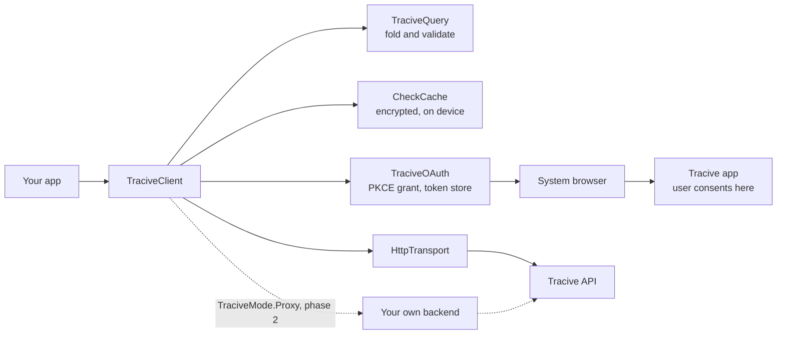

# Tracive SDK for Kotlin Multiplatform

Client for the Tracive scammer-check Open API. Android and iOS from one common source set.

```kotlin
val result = client.checkScammer(TraciveQuery.phone("+62 812-3456-7891"))
if (result.riskTier == RiskTier.HIGH) {
  warnTheUser(result.reportTotal, result.disclaimer)
}
```

---

## Status — read this before you plan around it

**phase 1 is OAuth mode only.**

Three separate facts, none of which this README will pretend otherwise about:

1. **Sandbox and production are separate registrations.** Both environments answer —
   `https://api-sandbox.tracive.id/v1` and `https://api.tracive.id/v1`, with consent in the matching
   build of the Tracive app — and each needs a client id issued for it, with your redirect registered
   on that client. A sandbox client id is unknown to production. Build against
   `TraciveEnvironment.Sandbox`; `Production` is the default.
2. **Proxy mode is phase 2.** `TraciveMode.Proxy` exists in the public surface today so that adding
   the behaviour later is not a breaking change for anyone. Any call made in Proxy mode throws
   `TraciveException.NotImplemented` right now. See [docs/proxy-contract.md](docs/proxy-contract.md).
3. **The test suite never touches the network.** Query folding and validation, the encrypted
   on-device cache with its TTL policy, error mapping and the OAuth flow are all covered against an
   injected fake transport, so the suite needs no server and no credentials.

Version `0.2.1`. SemVer, and `0.x` means the surface can still move — it is frozen against the
cross-language contract shared with the Flutter and Swift SDKs, not against you, until `1.0.0`.

## There is no API key. There will never be one.

The SDK has **no API-key parameter anywhere in its public surface, in any mode.** Not on
`TraciveClient`, not on `TraciveMode.OAuth`, not on `TraciveMode.Proxy`. This is a design invariant
rather than a feature that has not been built yet, and it is worth being explicit about why:

A key shipped inside an APK or an IPA is a key that has been published. Anyone can pull it out with
`apktool` in about a minute, and from that moment every check they make is billed to you. The two
modes exist precisely so that a mobile app never holds a long-lived credential:

- **OAuth mode** — the user authorises in the Tracive app, and the app receives a short-lived token
  scoped to that user. Checks are billed to the user's own credits.
- **Proxy mode (phase 2)** — calls route through the partner's own backend, which is where a secret
  can actually be kept.

If you find yourself wanting a place to put a key, you want Proxy mode, and it is not ready yet.

---

## Install

On Maven Central:

```kotlin
// build.gradle.kts — in a multiplatform module, put it in commonMain.dependencies { }
dependencies { implementation("com.pleistocent:tracive-sdk:0.2.1") }
```

Requirements: Android `minSdk` 24, iOS 15+, Kotlin 2.3, JDK 17 to build.

## Quick start

```kotlin
val client = TraciveClient(
  mode = TraciveMode.OAuth(
    // TODO(partner): the client id you were issued at registration.
    clientId = "your-client-id",
    // TODO(partner): an App Link on a host you own, registered with Tracive, and matching
    // your manifest's intent filter exactly — scheme, host and path.
    redirectUri = "https://yourapp.example.com/oauth/callback",
    // TODO(partner): the narrowest set you need. Constants, not strings: the server rejects
    // the whole consent request when it does not recognise a scope name.
    scopes = listOf(TraciveScopes.SCAMMER_CHECK, TraciveScopes.PROFILE_READ),
    // TODO(partner): your own stable, opaque id for this user. Required and never blank —
    // never a raw phone number or an email.
    partnerUserId = "your-user-id",
  ),
  // TODO(partner): TraciveEnvironment.Production before you ship.
  environment = TraciveEnvironment.Sandbox,
)

// 1. Authorise once. Opens the Tracive app's consent screen in a Custom Tab and returns.
when (val start = client.oauth!!.authorize()) {
  null -> waitForTheRedirect()                                 // the page is open
  is AuthResult.AppNotInstalled -> tellUserToInstallTracive()   // already sent them to the store
  is AuthResult.Failed -> report(start.error)                   // nothing was opened
  else -> error("authorize() returns nothing else")
}

// 2. Route the redirect back in, from onNewIntent / onOpenURL, in a coroutine. This is where the
//    authorization actually ends — never discard what it returns.
when (val auth = client.oauth!!.handleCallback(incomingUrl)) {
  null -> keepRoutingThisDeepLink()                            // not a Tracive redirect
  is AuthResult.Authorized -> proceed(auth.grantedScopes)
  // TODO(partner): confidential clients only — your backend completes the exchange with the
  // client secret. Send these over TLS to your backend and nowhere else.
  is AuthResult.CodeReceived -> sendToOwnBackend(auth.code, auth.codeVerifier, auth.redirectUri)
  is AuthResult.Denied -> respectThat()
  is AuthResult.Failed -> report(auth.error)
  else -> Unit                                                 // AppNotInstalled never arrives here
}

// 3. Check.
val result = client.checkScammer(TraciveQuery.phone("+6281234567891"))
```

The split is not cosmetic. Consent happens inside the Tracive app, so your app is in the
background throughout and Android may kill it; a call parked waiting for the redirect would be gone
by the time it arrived. `handleCallback` reads the pending authorization back from the secure store,
so a grant survives that — and it is the one place an authorization ever succeeds.

Full walkthrough, including the Android and iOS wiring: [docs/integration.md](docs/integration.md).

## How it works

`TraciveClient` is the entry point and owns four collaborators. `TraciveQuery` folds and validates
the identifier before anything is sent, `CheckCache` answers from the device when it can,
`TraciveOAuth` obtains and keeps the grant, and `HttpTransport` is the one place the SDK touches the
network. The user consents inside the Tracive app rather than in a WebView, so your app never sees
their Tracive credentials and never holds a long-lived one of its own.



The authorization flow, the single-flight token refresh, the cache decision path and the folding
grammar each have their own diagram in [docs/architecture.md](docs/architecture.md).

## What you can query

```kotlin
TraciveQuery.phone("+6281234567891")
TraciveQuery.email("Someone@Example.COM")
TraciveQuery.bankAccount(countryAlpha3 = "IDN", bankCode = "BCA", account = "1234567890")
TraciveQuery.bankAccountByShortCode(countryAlpha3 = "IDN", bankShortCode = "014", account = "1234567890")
TraciveQuery.bankAccountByBic(countryAlpha3 = "IDN", bic = "CENAIDJA", account = "1234567890")
TraciveQuery.iban("GB82 WEST 1234 5698 7654 32")
TraciveQuery.crypto(chain = "ETH", address = "0xAbC…")
TraciveQuery.username(platform = "instagram", handle = "@SomeHandle")
```

Every builder folds its input into a canonical `searchQueryIndex` — the same string the Flutter and
Swift SDKs produce for the same input, pinned by a shared fixture (`query-grammar-vectors.json`)
that all three repos vendor verbatim. Invalid input throws `TraciveQueryException` **before**
anything is sent, because a key that cannot possibly hit would still be billed.

If you store a bank by its national bank code (`014`) or its BIC (`CENAIDJA`) rather than by
Tracive's bank code (`BCA`), use `bankAccountByShortCode` or `bankAccountByBic`. The SDK translates
the code with the Tracive API's own table, which it ships, so all three bank lines above build the
same query and share one cache entry. A code the table does not list for that country throws
`unknown_bank_code` instead of being sent.

That is also why two of the builders check shape and not just emptiness. `phone()` requires E.164,
and `email()` requires an `@`. Neither is validated server-side, so `EMAIL_budi` and
`PHONE_081234567891` are legal keys: without the client-side check they would be looked up, missed,
and charged for. The email check is `@`-presence only — a fuller address grammar would reject
addresses the server would have matched, which is the worse mistake.

### Local phone formats: `normalizePhoneNumber`

`phone()` takes E.164 and nothing else, so `081234567891` is refused rather than guessed at — the
SDK cannot know your dial code, and a wrong guess still costs a credit. `normalizePhoneNumber`
supplies the dial code, so you can accept numbers the way people in each country actually write
them:

```kotlin
// Indonesians share numbers starting 08. Both of these produce PHONE_+6285718609079.
TraciveQuery.phone(normalizePhoneNumber("IDN", "0857-1860-9079"))
TraciveQuery.phone(normalizePhoneNumber("+62", "0857 1860 9079"))

// Or with the enum, when the country is known at compile time.
TraciveQuery.phone(normalizePhoneNumber(Country.INDONESIA, "0857 1860 9079"))
```

The first argument is either an **ISO 3166-1 alpha-3** code (`IDN`, `USA` — case-insensitive) or a
dial code with or without `+` (`+62`, `62`). They are told apart by shape: letters mean alpha-3,
digits mean a dial code. Alpha-2 (`ID`) is refused, because this SDK speaks alpha-3 everywhere and
accepting both would let your `US` mean one thing here and another in `bankAccount()`.

It is a plain public function, not something hidden inside `phone()`, because you need the E.164
form for your own records, logging and outbound messaging too — not only for a Tracive lookup.

What it handles, per country:

| Input | Country | Result |
|---|---|---|
| `0857-1860-9079` | `IDN` | `+6285718609079` — trunk prefix `0` dropped |
| `0062857 1860 9079` | `IDN` | `+6285718609079` — international prefix `00` dropped |
| `+62 857 1860 9079` | `IDN` | `+6285718609079` — already international, not doubled |
| `1 555 123 4567` | `USA` | `+15551234567` — NANP trunk prefix `1` dropped |
| `8 912 345 67 89` | `RUS` | `+79123456789` — Russian trunk prefix `8` dropped |
| `06 1234 5678` | `ITA` | `+390612345678` — Italy's leading `0` **kept**; it is part of the number |
| `+64 857 1860 9079` | `IDN` | **throws `country_conflict`** — the `+64` contradicts `IDN` |
| `+0062 857 1860 9079` | `IDN` | **throws `country_conflict`** — `+` and `00` do not stack |

Those last two rows are the rules these SDKs do *not* share with the Tracive app, and they differ
in kind. The first is safe: every input it rejects produced an unusable key in the app too. The
second is not — the app accepts `+00<dial>` and folds it correctly, so here the SDK is genuinely
stricter. `+` and `00` are alternative spellings of the same thing rather than stackable ones: what
follows `+` must be a country code, and `00` is none. The stored key is `PHONE_+<dial><number>`, and
admitting one malformed concatenation has no principled stopping point (`+000062`, `++62`). A `+` says the number
is already international; if the code that follows disagrees with the country you named, both cannot
be right, and guessing produces a key that can never match — billed as a miss.

`Country` is an enum of 245 entries with `dialCode`, `alpha2`, `alpha3` and `countryName`, and
`Country.fromAlpha3("idn")` looks one up case-insensitively.

These rules are a deliberate copy of the Tracive app's own normalizer, pinned by
`phone-normalization-vectors.json` — vendored byte-identically into all four SDK repositories, like
the grammar fixture. If the app folded a number one way and this SDK another, the same person would
become two record keys, and a report filed in the app would be invisible to a check made here.

**There is no `domain()` builder.** The Tracive API never shipped a DOMAIN type, so no record with
a `DOMAIN_` id exists. Building such a key would guarantee a miss, and misses cost money.

## Cost, and the two things that most affect your bill

Every request that reaches the server is billed, **a miss included** — the server did the lookup
either way. Two consequences worth internalising:

**Do not call `credits()` before each check.** It is one extra round trip per transaction and it
tells you nothing you will not learn anyway. Make the check and handle
`TraciveException.InsufficientCredits` (HTTP 402) when it comes. Call `credits()` to *display* a
balance, not to gate a call.

**Do not retry a failed check without an `idempotencyKey`.** A 5xx or a timeout does not tell you
whether the server processed the check before it failed, so a blind retry is a request to be charged
twice. The SDK will not do it: `checkScammer` retries **only** when you passed an `idempotencyKey`,
which the server uses to collapse the repeat onto the original charge.

```kotlin
val key = randomUuid()  // one per logical check; reuse it only to retry that same check
val result = client.checkScammer(query, idempotencyKey = key)
```

## Caching

On by default in policy, off by default in wiring — the persistent cache needs a platform database
and a platform key store, so you construct it and pass it in ([docs/caching.md](docs/caching.md)
shows both platforms). What it gives you:

| Risk tier | Default TTL |
|---|---|
| `HIGH` | 30 days |
| `ELEVATED` | 7 days |
| `CAUTION` | 24 hours |
| `NONE` | 1 hour |

A hit costs zero credits and does zero network I/O, so it also works offline. These numbers are the
whole of the policy — there is no per-response override — so pass your own `CachePolicy` if you want
different ones.

Privacy: the row key is `SHA-256(searchQueryIndex)` and the payload is AES-256-GCM. **The identifier
itself is never written to disk in any form**, and neither is the risk tier or the report count.

The same store also records **what a given transaction was shown**, so a transaction-detail screen can
still display the check weeks later:

```kotlin
client.cache.putTransactionCheck("TRF26090814320771", result)   // once the transfer has a reference
client.cache.getTransactionCheck("TRF26090814320771")           // null = no check on file
```

Each one is a snapshot on its own 90-day retention, so a later check of the same account cannot
rewrite an older transaction's card, and one check can be recorded against several transactions —
the second transfer to an account you already checked costs nothing and still gets a card. See
[docs/caching.md](docs/caching.md#recording-what-a-transaction-was-shown).

## Report a scammer

A "Report" button on a transaction detail screen can open the Tracive app's report form with the
account, the transaction date and the receipt already filled in:

```kotlin
when (val result = client.openReportForm(
  query = TraciveQuery.bankAccount("IDN", "BCA", transfer.accountNumber),
  incidentDate = transfer.date,                                   // kotlinx.datetime.LocalDate
  attachments = listOf(
    ReportAttachment.image(receiptPng, "image/png"),
    ReportAttachment.pdf(receiptPdf),                             // under 1 MiB
  ),
)) {
  is ReportFormResult.Opened ->
    if (!result.attachmentsDelivered) tellUserToAttachTheReceiptInTracive()   // an older app
  ReportFormResult.Cancelled -> Unit            // iOS: the user closed the sheet or picked another app
  ReportFormResult.InstallPageOpened -> Unit    // no app: the install page is already open
  is ReportFormResult.Failed -> show(result.error)              // nothing was opened
}
```

It needs no grant, no token and no credit, and sends nothing over the network, so it works for a
`CONFIDENTIAL` client too. The files stay on the phone until the user submits the report in
Tracive. The input is checked against the app's own limits first (date not after today; 5
attachments, or 10 for a phone number; JPEG, PNG, WebP, HEIC, HEIF, BMP or PDF whose bytes match
the type; a PDF under 1 MiB; 20 MiB in all), and a failed check returns a typed `ReportFormError`
with nothing opened.

Two platform notes: on Android the SDK adds an unexported `FileProvider` to your merged manifest; on
iOS add `tracive-report` and `tracivesandbox-report` to `LSApplicationQueriesSchemes`. Both are
explained in [docs/integration.md](docs/integration.md#9-report-a-scammer).

## Errors

Everything throws a subclass of `TraciveException`, mapped from the server's `error.code`:

| You will see | When | What to do |
|---|---|---|
| `InsufficientCredits` | 402 | Prompt to top up. Do not pre-check with `credits()`. |
| `ExpiredToken` | 401 | Nothing — the SDK refreshes and retries once, single-flight. |
| `GrantRevoked` | 401 | Tokens are already cleared. Send the user through `authorize()` again. Never retry. |
| `InvalidToken` | — | No usable grant is stored: either nobody has authorised yet, or the stored record lost its access token and had no refresh token left to renew from. Send the user through `authorize()`. Nothing was sent to the server. |
| `UserCreditNotPermitted` | 403 | Your contract does not let you charge the user's subscription credits. Contact Tracive; retrying will not help. |
| `TranslationNotPermitted` | 403 | A `Detail.FULL` check asked for a non-English `locale`, and your contract withholds translation or the user has no premium subscription. Check again without `locale` for the English result. |
| `RateLimited` | 429 | Wait `retryAfter`. Never auto-retried. When `isDailyQuotaExceeded` is `true` a daily allowance is spent (the connection's daily quota, its account reads, or the sandbox org cap) and `retryAfter` points at 00:00 UTC: tell the user to try later. |
| `CacheMiss` | — | `Source.CACHE` with no live entry. Never a silent empty result. |
| `NotImplemented` | — | You called something in Proxy mode. |

An unrecognised code maps to `Server` or `Unknown` carrying the raw code. The SDK never crashes on a
response shape it does not know, and unknown JSON fields are ignored rather than fatal — phase 2 will
add fields, and a build shipped today must survive them.

## Surfacing results

`CheckResult.disclaimer` carries the text the backend requires you to show alongside a verdict.
**Display it.** A risk tier is aggregated user-reported evidence, not an adjudication, and presenting
it as a verdict on a named person is a legal problem for you rather than for us.

Also note `relatedScammerCount` is a count and never a list — the SDK will not hand you other
people's identifiers.

## Building this repo

```bash
./gradlew build                    # compile + test, all targets
./gradlew :tracive-sdk:testAndroidHostTest   # the common test suite, on the JVM — fastest loop
./gradlew ktfmtFormat              # reformat (ktfmt, Google style, 2-space indent)
./gradlew ktfmtCheck               # verify formatting; wired into `check`
./gradlew apiDump                  # regenerate the public-API snapshot after a deliberate change
```

Every test in this repo runs **with no network**. The HTTP transport is an injected interface
(`HttpTransport`), and the suite runs against a fake. No test may hit a real host — there is not one
to hit, and a suite that needed one would be untestable in CI anyway.

Formatting is ktfmt **Google style, 2-space indent**, enforced by `ktfmtCheck` in `check`. The public
surface is pinned by the binary-compatibility-validator, in two files — `api/tracive-sdk.klib.api`
for the Apple targets and `api/tracive-sdk.android.api` for Android. `apiCheck` fails CI on an
unintended change to either, and the fix is `./gradlew apiDump` plus a look at the diff — the look is
the point.

## Documentation

- [docs/architecture.md](docs/architecture.md) — the diagrams: components, the PKCE flow, the token
  lifecycle, the check path, and identifier folding
- [docs/integration.md](docs/integration.md) — wiring the SDK into an Android or iOS app end to end
- [docs/oauth.md](docs/oauth.md) — the PKCE flow, redirect handling, token storage, refresh
- [docs/caching.md](docs/caching.md) — TTLs, encryption, invalidation, what is and is not stored
- [docs/proxy-contract.md](docs/proxy-contract.md) — the phase 2 contract, written down early
- [SECURITY.md](SECURITY.md) — reporting a vulnerability
- [CHANGELOG.md](CHANGELOG.md)

## Licence

Apache-2.0. See [LICENSE](LICENSE).
