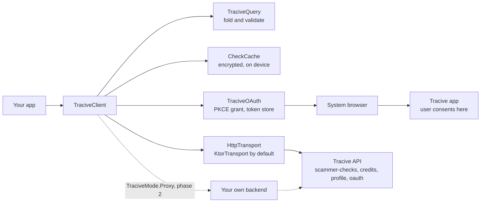
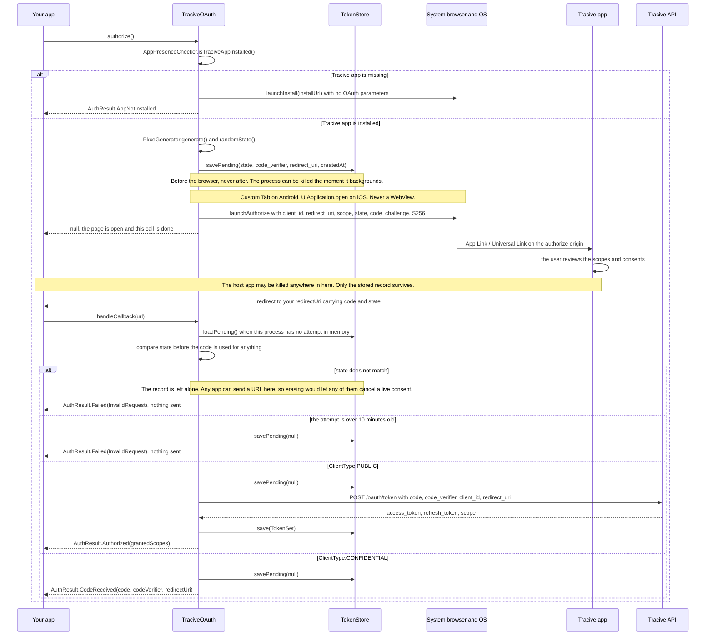
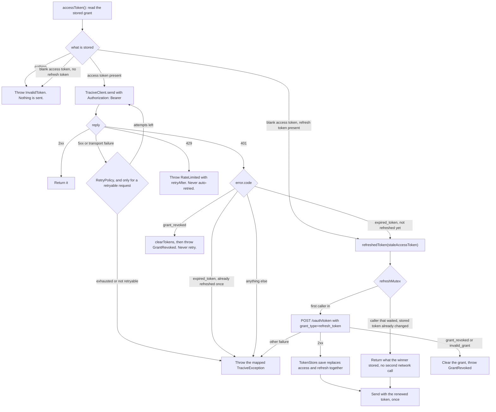
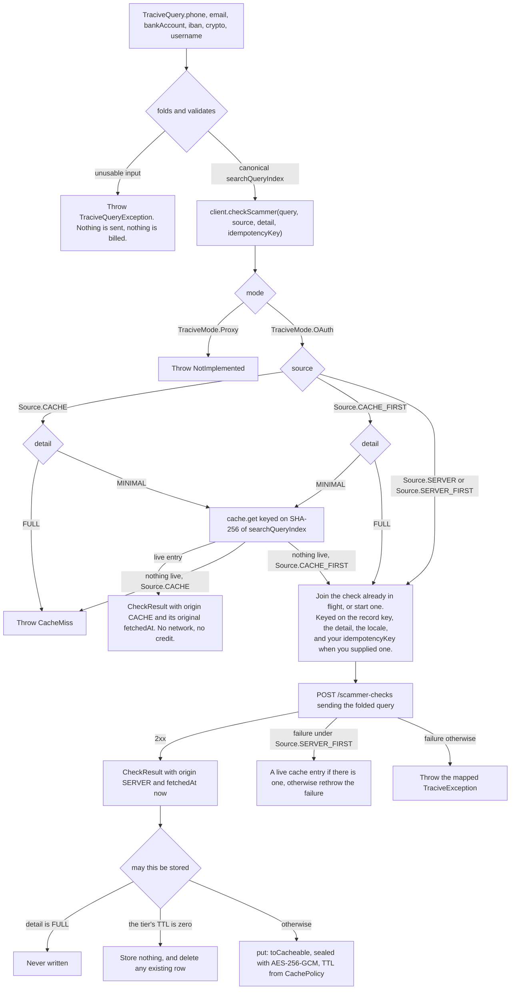
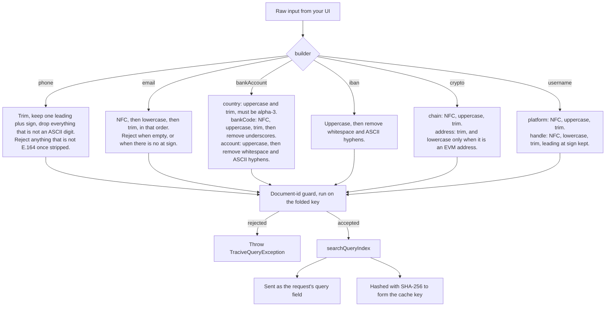

# Architecture

What the SDK is made of and how a call travels through it, in five diagrams. Nothing here is new
behaviour — every arrow is drawn from the code, and the prose points at the document that covers
each area in full.

Two things to keep in mind while reading, because they explain most of the shapes below:

- **A request that reaches the server is billed, a miss included.** That is why validation happens
  before the network, why folding happens on the device, and why the cache exists at all.
- **The tests never reach a server.** The paths in these diagrams are the ones the SDK builds and
  the ones its tests drive against an injected transport, in either environment; see the status
  section in the [README](../README.md).

---

## A. Where the SDK sits

`TraciveClient` is the entry point. It owns four collaborators: `TraciveQuery` folds and validates
the identifier, `CheckCache` answers from the device when it can, `TraciveOAuth` obtains and keeps
the grant, and `HttpTransport` is the single place the SDK touches the network.

Note that the authorization origin is not the API origin. Data calls go to the API host; the
authorize URL points at `tracive.id`, which is the origin the Tracive app claims as an App Link /
Universal Link, and that claim is what makes the consent step app-to-app instead of a web page.

The dotted path is `TraciveMode.Proxy`: calls routed through a partner backend that holds the
credential, billed to the partner rather than to the end user. The type is in the public surface
today so that adding the behaviour later breaks nobody, and every call made in that mode currently
throws `TraciveException.NotImplemented`. The contract it will honour is written down in
[proxy-contract.md](proxy-contract.md).

There is no API-key parameter in either mode, and there will not be one. A key shipped inside an APK
or an IPA is a key that has been published.

---

## B. OAuth authorization with PKCE

`authorize()` opens the page and returns; `handleCallback(url)` says how the authorization ended.
Two calls rather than one, because it is not one process: the consent screen belongs to the Tracive
app, so your app is in the background throughout and Android may collect it, and anything parked
waiting for the redirect would be gone by the time it arrived. The screen is never a WebView inside
your process either — an App Link does not fire from an in-app WebView, and RFC 8252 forbids
embedded user agents for OAuth anyway.

PKCE is `S256` only. The verifier stays on the device and only its SHA-256 digest travels in the
authorize URL, which is what stops an intercepted authorization code from being redeemable.

The verifier is also written to the token store *before* the browser opens, as a
`PendingAuthorization` carrying `state`, the verifier, the redirect URI and a timestamp. That record
is what a redirect arriving in a *new* process is completed from: `handleCallback` reads memory
first and the store second, so a killed app comes back to a finished authorization rather than a
dead flow. It is refused once it is ten minutes old — the authorization code's own lifetime — and
erased on every outcome that consumes the attempt, so a spent one cannot be replayed. A callback
whose `state` does not match is refused without erasing anything: any app on the device can send one,
and a consent the user is still giving must not be cancellable by a stranger's URL.

Every outcome is a value rather than an exception, and all but one of them arrives at
`handleCallback`:

- **`AuthResult.AppNotInstalled`** — the only outcome `authorize()` itself reports, alongside a
  `Failed` for an OS that would not open the page. The install page is already open. There is no
  deferred resume; the user installs Tracive, comes back, and tries again.
- **`AuthResult.Denied`** — the user declined. A host whose browser closed with no redirect calls
  `cancelPendingAuthorization()` instead, which erases the record and returns a `Boolean`; there is
  nothing waiting to be told.
- **`AuthResult.Failed`** — including a `state` mismatch, which surfaces as
  `TraciveException.InvalidRequest`, never redeems the code, and leaves the pending record intact so
  the genuine redirect can still finish the job.
- **`AuthResult.CodeReceived`** — a confidential client stops here and its own backend performs the
  exchange, then hands the tokens back through `adoptTokens(...)`.

`handleCallback(url)` returns `null` for a URL that is not this client's redirect or that carries
none of `state`, `code` or `error`. Treat `null` as "not mine" rather than as an error, and go on
routing the link. A redirect that *is* this client's but has nothing left to complete answers
`AuthResult.Failed(InvalidRequest)`, so deliver each one once.

A redirect arriving in a **new process** completes normally. The `PendingAuthorization` outlives a
process death and `handleCallback` reads it back from the store, so the grant the user consented to
is not thrown away because Android reclaimed some memory while they were in another app. Full detail
in [oauth.md](oauth.md).

---

## C. Token lifecycle

The SDK does not read `expiresAt` to decide whether a token is still good. It sends the token,
takes the 401, refreshes, and repeats the request once — which costs one wasted round trip per
expiry and avoids a fast device clock refreshing far more often than the grant needs.

Refresh is single-flight, and that is a correctness requirement rather than an optimisation.
Refresh tokens rotate, so two simultaneous refreshes would present the same token twice; the second
presentation is indistinguishable from a stolen-token replay, and the server answers reuse by
revoking the whole grant.

There is one local check before any of that, and it is the only one: a stored access token that is
**blank** is renewed before the request is built. That is damage, not expiry — see the third note
below — and it is the sole route into a refresh that a server did not ask for.

Three details worth stating plainly:

- **`invalid_grant` is treated exactly like `grant_revoked` on the refresh path.** A standards-shaped
  authorization server answers a *reused* refresh token that way, and both readings are terminal:
  the stored grant is cleared, because sending it again looks like an attack.
- **A caller that lost the race performs no network call.** It takes the mutex, sees that the stored
  access token is no longer the one it failed with, and returns that instead.
- **A blank stored access token is damage, and the reactive path cannot repair it.** An interrupted
  write or a restored backup can empty that field while leaving the refresh token intact, and an
  empty bearer is answered with `invalid_token` rather than `expired_token` — terminal here, so the
  record would fail permanently instead of healing on a retry. It is renewed locally instead, and
  only the *blank* case is: nothing else consults the stored token before sending it.

"Retryable" in the diagram is narrower than it looks. `GET /credits` and `GET /profile` are safe to
repeat by definition, but a check is repeated **only when the caller supplied an `idempotencyKey`** —
a 5xx or a timeout does not say whether the server processed the check before it failed, so a blind
retry is a request to be charged twice, and there is nothing for the server to collapse the repeat
onto without a key.

`signOut()` revokes the refresh token best-effort and then clears the local grant whatever happened,
because a revoke that failed for being offline must still leave the user signed out on this device.

---

## D. What happens on a check

Validation runs first and it runs locally: a `TraciveQuery` that exists has already passed, and an
unusable identifier raises `TraciveQueryException` before a single byte is sent. Only then does the
routing below apply.

Between the routing and the request sits a latch. Two checks for the same record key, detail and
locale — a double-tapped button, or the same number appearing twice in a list — become one request
and one bill rather than two. Your own `idempotencyKey` is part of the latch key, so two callers who
deliberately keyed themselves apart stay apart; a caller who passes no key changes nothing. The cache
write happens inside the flight, so a collapsed check is also stored once.

**What is deliberately not cached, and why.**

- **A full-detail answer, ever.** The cache is keyed on the query alone, and only a full-detail
  request sends a `locale` at all. `toCacheable()` drops `topChronologies` and `comments`, but it
  keeps `tags` and `disclaimer`, and both of those vary with the locale — so storing a full-detail
  answer would file locale-specific text under a locale-less key for the next minimal caller to read
  straight back. `disclaimer` is the one string every integrator is asked to put on screen. Caching
  full detail would first require the key to become the triple of query, detail and locale.
- **A tier whose TTL the host has set to zero.** Zero means "do not keep answers of this tier", so
  nothing is stored *and* any existing row for that query is removed — otherwise a superseded
  verdict would keep being served for the rest of its old lifetime.
- **Anything that failed.** Only a decoded 2xx result reaches `put`.

A `Source.CACHE` lookup with no live entry raises `CacheMiss` rather than returning an empty
`CheckResult`, because an empty result reads as "this identifier is clean" — the most dangerous
wrong answer this SDK can give. On the way in, `toCacheable()` also drops `checkId` and `billing`.

Expiry is lazy: a read that finds an expired row deletes it and reports a miss, so correctness never
depends on a background sweeper. TTLs, the encryption envelope and the key store are covered in
[caching.md](caching.md).

---

## E. Identifier folding

Every builder turns a raw identifier into one canonical `searchQueryIndex`, which is both what goes
on the wire as the request's `query` field and what the cache hashes for its key — so the two can
never disagree about what was asked.

The rules are not the SDK's own invention: they mirror the Tracive API's canonical key normalizer,
and `query-grammar-vectors.json` pins all four implementations to byte-identical output. That file
is vendored verbatim into this repo and into the Flutter and Swift SDKs, and it is the reason the
folds below are written against JavaScript string semantics rather than Kotlin's — the two disagree
about whitespace, digits, case mapping and the regex dot, silently, in every case.

Worked examples, all of them vectors from the shared fixture:

| Builder | Input | `searchQueryIndex` |
|---|---|---|
| `phone` | `+1 (415) 555.2671` | `PHONE_+14155552671` |
| `email` | `Budi@Gmail.com` | `EMAIL_budi@gmail.com` |
| `bankAccount` | `IDN`, `B_CA`, `3242-4242-422` | `BANK_IDN_BCA_32424242422` |
| `iban` | `DE89 3704 0044 0532 0130 00` | `BANK_IBAN_DE89370400440532013000` |
| `crypto` | `ETH`, `0x52908400…4169EE7` | `CRYPTO_ETH_0x52908400…4169ee7` |
| `username` | `TIKTOK`, `@ScammerX` | `USERNAME_TIKTOK_@scammerx` |

Four folds look like oversights and are not:

- **A leading `@` on a handle is kept.** The backend keeps it, so `@scammerx` and `scammerx` are
  separate entities there, and stripping it here would miss every report filed with it.
- **Only an EVM address is lowercased.** The test is the address's shape, never the chain code,
  because several chains accept both an EVM address and a base58 one. base58 is case-sensitive and
  lowercasing one produces a different, invalid address. An address written with an uppercase `0X`
  prefix fails the backend's own EVM test too, so it is stored unfolded on both sides and the SDK
  leaves it alone rather than "fixing" it into drift.
- **NFC is applied to a crypto chain code but not to the address.** Addresses are ASCII by
  construction, and normalising one would be a fold the backend does not perform.
- **Underscores are removed from a bank code but kept in an account number.** The id is parsed by
  splitting on `_`, so an underscore in the code would shift the account number into the code's
  position — while everything past the code is rejoined, which makes `123_456` a legitimate account.

Two builders check shape rather than mere emptiness, and both checks exist purely to avoid a billed
miss: `phone` requires E.164 because the server cannot up-convert a local number it has no dial code
for, and `email` requires an `@` because the server validates no shape at all, so `EMAIL_budi` would
be looked up, missed and charged. The email test is `@`-presence and nothing more — a fuller address
grammar would reject addresses the server would have matched, which is the worse mistake.

**There is no `domain()` builder.** The Tracive API indexes exactly five identifier types — PHONE,
EMAIL, BANK, CRYPTO and USERNAME — so a `DOMAIN_` key could only ever miss, and a miss is billed.

The document-id guard runs on the *folded* key, never on the caller's input, because case mapping is
not length-preserving. It rejects an empty key, one containing `/`, one that is exactly `.` or `..`,
one carrying an unpaired UTF-16 surrogate, one over 1500 UTF-8 bytes, and one matching the server's
reserved `__…__` shape. Almost none of those can fire for a key a public builder produced — every
builder prefixes its type — and the guard is written for the raw path, where a key arrives
unprefixed.

---

## Where to read more

- [integration.md](integration.md) — wiring the SDK into an Android or iOS app end to end
- [oauth.md](oauth.md) — the PKCE flow, redirect handling, token storage, refresh
- [caching.md](caching.md) — TTLs, encryption, invalidation, what is and is not stored
- [proxy-contract.md](proxy-contract.md) — the phase 2 contract, written down early
